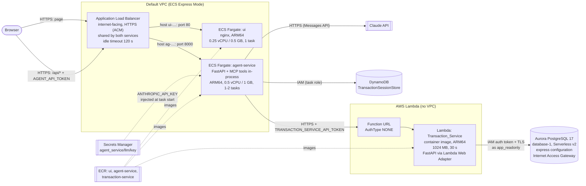
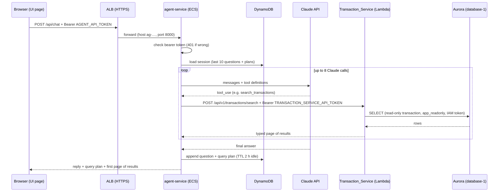

# Deployment architecture (AWS)

How the Transaction Dashboard runs in AWS, as deployed in November 2026. Everything is in one
project and one Region: **us-east-1**. The local Docker setup is unchanged (README).

## 1. Overview

| Tier | Component | AWS service | Address |
|---|---|---|---|
| Presentation | React UI (static, nginx) | ECS Express Mode (Fargate) | `https://ui-152c7e30b79a46818ca407377ac9d9fd.ecs.us-east-1.on.aws` |
| Application | Agent service (Claude tool loop, MCP tools in-process, sessions) | ECS Express Mode (Fargate) | `https://ag-89d0bad6fcb046b0b1210bc2d0e0e1e4.ecs.us-east-1.on.aws` |
| Application | Transaction Service (read-only search API) | Lambda (container image) + Function URL | `https://yhj7eucavfhhcstysswzc3ctou0cbzvn.lambda-url.us-east-1.on.aws` |
| Data | Transactions, payments, refunds, chargebacks | Aurora PostgreSQL Serverless v2 (`database-1`) | IAM-auth endpoint, no passwords |
| Data | Agent session memory (questions + query plans only) | DynamoDB (`TransactionSessionStore`) | — |
| Secrets | Anthropic API key | Secrets Manager (`agent_service/llm/key`) | — |
| Images | Container images | ECR (`ui`, `agent-service`, `transaction-service`) | `219806732458.dkr.ecr.us-east-1.amazonaws.com/<repo>` |

## 2. One question, end to end

Paging and "execute plan" go from the agent straight to the Transaction Service, without Claude.

## 3. Services

### UI: ECS Express Mode service `ui-c89b`
| Setting | Value |
|---|---|
| Image | ECR `ui` (`ui/Dockerfile`): Vite build + nginx 1.27, 22 MB |
| Runtime config | `AGENT_API_URL`, `AGENT_API_TOKEN` env vars, written into the bundle at container start (`ui/docker-entrypoint.d/40-agent-config.sh`). The image holds neither |
| Port / health check | 80 / `/healthz` |
| Compute | ARM64, 0.25 vCPU / 0.5 GB, 1 task |
| Execution role | `ui-execution` (image pull, logs) |

### Agent service: ECS Express Mode service `agent-service-d491`
| Setting | Value |
|---|---|
| Image | ECR `agent-service` (`agent_service.Dockerfile`): agent packages only, uvicorn, non-root, keep-alive 130 s |
| Port / health check | 8000 / `/health` |
| Compute | ARM64, 0.5 vCPU / 1 GB, min 1 / max 2 tasks (CPU target 60%) |
| Environment | `AUTH_ENABLED=true`, `AGENT_API_TOKEN`, `TRANSACTION_SERVICE_URL`, `TRANSACTION_SERVICE_API_TOKEN`, `TRANSACTION_SERVICE_TIMEOUT_SECONDS=30`, `MCP_TOOL_CALL_TIMEOUT_SECONDS=45`, `SESSION_STORE=dynamodb`, `SESSION_TABLE_NAME=TransactionSessionStore`, `SESSION_AWS_REGION=us-east-1`, `CORS_ALLOWED_ORIGINS` (localhost:5173 + the UI URL) |
| Secret | `ANTHROPIC_API_KEY` ← `agent_service/llm/key` (JSON field), injected by ECS |
| Roles | execution `agent-service-execution`, task `agent-service-task` |
| Plan cache | off (`PLAN_CACHE_ENABLED` unset); no Chroma in AWS |

### Transaction Service: Lambda `Transaction_Service`
| Setting | Value |
|---|---|
| Image | ECR `transaction-service` (`transaction_service.Dockerfile`): FastAPI + uvicorn + Lambda Web Adapter extension |
| Front door | Function URL, `AuthType NONE`; the app requires `TRANSACTION_SERVICE_API_TOKEN` on `/api/v1/*` |
| Compute | ARM64, 1024 MB, 30 s timeout, no VPC |
| Environment | `POSTGRES_DSN_READONLY` (no password), `DATABASE_IAM_AUTH=true`, `DATABASE_AWS_REGION`, `DATABASE_POOL_SIZE=1`, `DATABASE_MAX_OVERFLOW=0`, `TRANSACTION_SERVICE_API_TOKEN` |
| Role | `transaction-service-lambda` |
| Startup | Opens the pool and refuses to start if its account could write (`ensure_cannot_write`) |

## 4. Data

| Store | Configuration | Access |
|---|---|---|
| Aurora PostgreSQL 17 `database-1` | Serverless v2, express configuration: Internet Access Gateway, no customer VPC, **IAM-only sign-in**; scales 0–4 ACU, pauses after 5 idle minutes | `app_readonly` (Transaction Service: SELECT only, read-only transactions, 5 s statement timeout); `app_owner` (migrations, seed: run from a laptop); both `rds_iam`, no passwords |
| DynamoDB `TransactionSessionStore` | On-demand; key `sessionId`; TTL `ttl_session` | `agent-service-task` only. One item per session: last 10 questions + plans, never results |

Setup from a laptop (AWS profile signed in): `make aurora-bootstrap migrate seed`
(or `make seed-daily FROM=2026-10-01` for demo data with a few transactions every day).

## 5. Security

**Network exposure**

| Entry point | Reachable by | Guarded by |
|---|---|---|
| UI URL | Anyone | Nothing (static page) |
| Agent URL `/api/*` | Anyone | HTTPS; `AGENT_API_TOKEN`; CORS (UI + localhost only) |
| Transaction Service Function URL `/api/v1/*` | Anyone | HTTPS; `TRANSACTION_SERVICE_API_TOKEN` |
| ECS tasks | Only the load balancer | Security groups created by Express Mode |
| Aurora | Anyone with valid IAM credentials | IAM auth tokens (15 min) + TLS; per-user `rds-db:connect` |

**IAM roles (least privilege)**

| Role | Used by | Allows |
|---|---|---|
| `agent-service-execution` | ECS, before the agent starts | Pull image, write logs, read **only** `agent_service/llm/key` |
| `agent-service-task` | Agent code | Get/Put/Update/Delete on **only** `TransactionSessionStore` |
| `ui-execution` | ECS, before the UI starts | Pull image, write logs |
| `ecsInfrastructureRoleForExpressServices` | ECS Express Mode | Manage the load balancer, certificate, security groups, scaling |
| `transaction-service-lambda` | Transaction Service code | Write logs; `rds-db:connect` as **only** `app_readonly` |

The ECS task roles trust only ECS acting for this account (`aws:SourceAccount`, `aws:SourceArn`).

**Secrets**

| Secret | Where it lives |
|---|---|
| `ANTHROPIC_API_KEY` | Secrets Manager; ECS injects it (never in task definitions) |
| `AGENT_API_TOKEN` | Agent + UI env vars; **sent to every browser that opens the UI** |
| `TRANSACTION_SERVICE_API_TOKEN` | Agent + Lambda env vars |
| Database credentials | None: IAM auth tokens signed at connect time |

Settings errors never print values (`hide_input_in_errors`). Rotate the service tokens with
`make rotate-tokens`, then update the agent, UI and Lambda environment variables.

## 6. Build and deploy

| Step | Command / place |
|---|---|
| Build + push an image (arm64, unique immutable tag) | `make push-image SERVICE=ui\|agent-service\|transaction-service` |
| Deploy the Transaction Service | Lambda console → Image → Deploy new image (or `aws lambda update-function-code --image-uri …`) |
| Deploy the agent / UI | ECS console → the Express Mode service → Update → new image |
| Anthropic key | `make push-secrets` (from `.env`) or the Secrets Manager console |

Images are built with `--provenance=false` (Lambda rejects attestation manifests) and pinned
by digest in the services.

## 7. Operations

| Topic | Detail |
|---|---|
| Logs | CloudWatch: `/aws/lambda/Transaction_Service` (14 d), `/aws/ecs/default/agent-service-d491-0bdc` (14 d), the UI's Express Mode log group |
| Timeouts | ALB idle 120 s < uvicorn keep-alive 130 s; agent → Transaction Service 30 s per attempt (2 retries); Lambda 30 s |
| Cold starts | Lambda ~1–3 s; ~15–25 s when Aurora was paused (first request after idle) |
| Express Mode | Owns the ALB, target groups and listener rules; re-check the 120 s idle timeout after service updates |
| Stop costs | Delete the two ECS services (the ALB goes with the last one); stop `database-1` (AWS restarts a stopped cluster after 7 days) |

**Approximate monthly cost while running** (Free plan credits): ALB ~$16–18, agent task ~$12–14,
UI task ~$6–7, Aurora when not paused, Secrets Manager $0.40; Lambda, DynamoDB and ECR pennies.

## 8. Known limitations (demo setup)

- **The agent token is public once the UI is.** Anyone opening the UI can read it and call the
  agent (Claude costs). Before real users: Amazon Cognito sign-in, or an AWS WAF IP allowlist on
  the load balancer.
- The Transaction Service Function URL is public, guarded only by its token (option: `AWS_IAM`
  with signed calls from the agent).
- Single Region; Aurora has 1-day backups and no deletion protection.
- The plan cache (Chroma) is not deployed.
