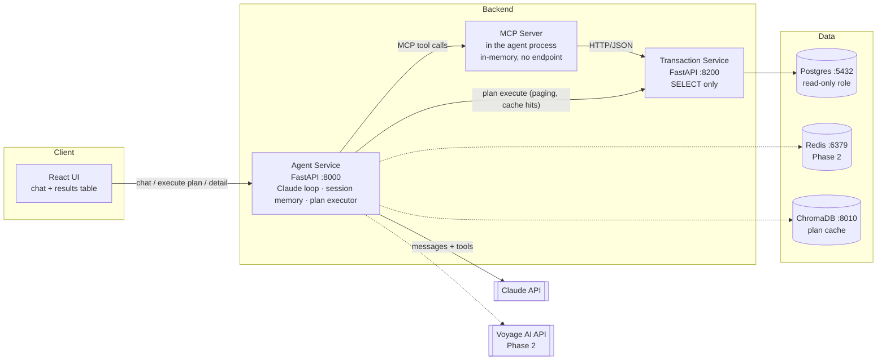
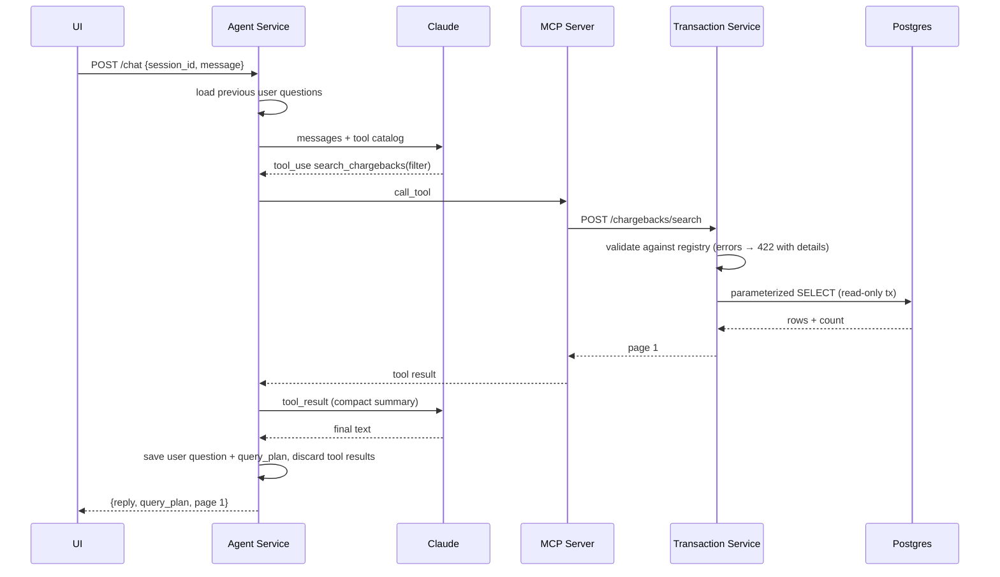
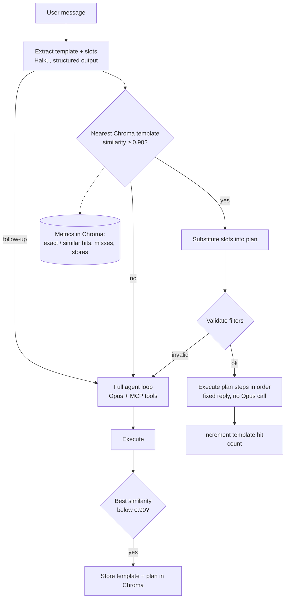
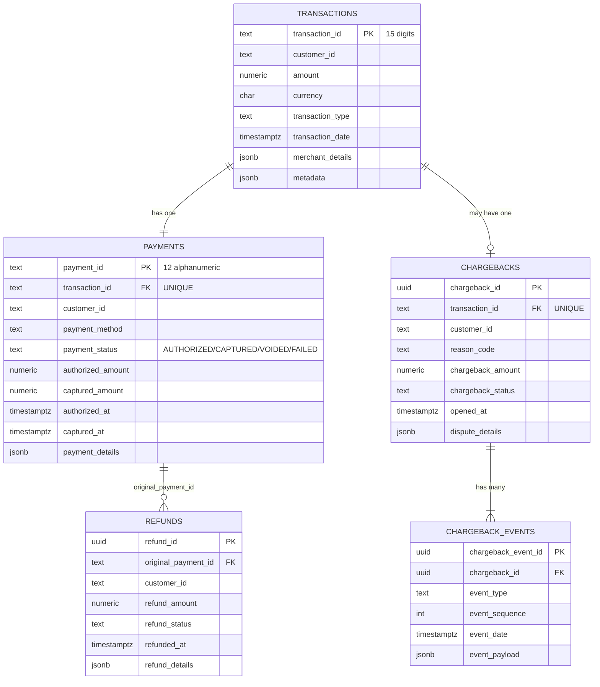

# Transaction Dashboard — High-Level Design (HLD)

| | |
|---|---|
| Status | Draft v1 |
| Source spec | [specs.md](specs.md) |
| Companion | [LLD.md](LLD.md) (low-level design + task breakdown) |
| Last updated | 2026-10-26 |

---

## 1. Purpose

Let a user ask questions about payment transactions in natural language ("show chargebacks this month for customer 10001641"), have an LLM agent turn that into safe, read-only API calls, and show the results in a paginated table with drill-down into a single transaction.

## 2. Scope

### In scope
- **Phase 1:** Postgres data store with seed data, read-only Transaction Service, MCP server, Claude-based agent with session memory, React UI with pagination.
- **Phase 2:** RAG lookup of query plans (Voyage embeddings in ChromaDB) with hit/miss metrics, and a click-through detail view. A Redis exact-match cache is on hold until the metrics show how often exact matches occur.

### Out of scope (for now)
- Writing data through the API (no insert, update or delete).
- Multiple users, user authentication, RBAC.
- Cloud deployment. Phase 1 runs on local `docker-compose` only.

## 3. Requirements → decisions

| # | Requirement | Decision |
|---|---|---|
| R1 | Tables: transactions, payments, chargebacks (with JSON columns) | Postgres 16 with JSONB columns. Also `refunds` and `chargeback_events` (see §6) |
| R2 | 100 rows of sample data | Deterministic seed script (Faker with a fixed seed) |
| R3 | 5 query use cases with dynamic filters | **General search tools** driven by a filter expression language (AND / OR / NOT / nested groups) |
| R4 | Extend with new filters easily | **Filter registry**: one entry per filterable field, including JSON paths. No other code changes |
| R5 | Read-only APIs, no SQL injection | The LLM never writes SQL. Filters are checked against a whitelist and compiled to parameterized SQLAlchemy. Read-only DB role |
| R6 | LLM checks the WHERE clause before running it | `validate_filters` tool, and structured validation errors from every search call so the LLM can correct itself |
| R7 | APIs exposed over MCP | **MCP server** (FastMCP) used only by the agent, never by outside clients (§11.9). Runs inside the agent service (`agent_service.mcp_server`), reached in memory: no network endpoint, port or token |
| R8 | Agent in front of the APIs; natural-language input | Agent Service runs a Claude tool-use loop and is an MCP client |
| R9 | Session memory and context | In-memory session store (Phase 1), single user. **Only the user's questions and each question's query plan (tool + filters) are stored.** Query results, tool results and assistant replies are never saved |
| R10 | Paginated UI | React. Paging reuses the returned **query plan** and **skips the LLM** |
| R11 | RAG over frequently used queries; stored plan keeps execution order, only filters are substituted | Query templates + parameterized plans in ChromaDB, embedded with Voyage AI |
| R12 | Redis cache in front of vector search | Exact-match template cache with a configurable TTL |
| R13 | Click a row to see transaction detail | `GET /transactions/{id}` returns the full aggregate (payment, refunds, chargeback, events) |
| R14 | Python, FastAPI, SOLID, DRY, clear names | uv workspace, layered packages, interfaces (Protocols) at every external boundary |

## 4. Architecture

### 4.1 Components

| Component | Responsibility | Does **not** |
|---|---|---|
| **React UI** | Chat panel, results table, pager, detail drawer (P2). Holds the current `query_plan` | Call the LLM or MCP directly |
| **Agent Service** (BFF) | `/chat`: runs the Claude tool-use loop over the MCP tools and returns reply + query plan + first page. `/plans/execute`: re-runs a plan for page N without the LLM. Session memory. P2: plan resolution (Redis → Chroma → LLM) | Touch Postgres or build SQL |
| **MCP Server** | Publishes the tool catalog with JSON schemas. Thin adapter that forwards to the Transaction Service. Internal: reached only by the agent (bearer token over HTTP, or in memory) | Hold business logic or accept outside clients |
| **Transaction Service** | Owns the domain: filter registry, validation, query building, pagination, detail aggregates | Accept writes or raw SQL |
| **Postgres** | System of record | — |
| **Redis** (P2) | Exact-match plan cache with TTL. Optional session store later | — |
| **ChromaDB** (P2) | Vector store of query templates → parameterized plans | — |

### 4.2 Why these boundaries
- **MCP server separate from the Transaction Service:** the tool catalog stays a thin, swappable layer, and the Transaction Service stays a plain REST service that can be tested on its own. The MCP server lives inside the agent service and has no endpoint, so it is **not** reachable by outside clients such as Claude Desktop (§11.9).
- **Agent Service also acts as the UI's backend (BFF):** the UI talks to one origin. Paging and cache hits go to the Transaction Service directly, with no MCP or LLM hop.
- **Agent is its own MCP client:** the Claude API's built-in MCP connector needs a publicly reachable server. Our MCP server runs locally in docker-compose, so the agent connects with the Python `mcp` SDK and passes the tools to Claude as ordinary tool definitions. The tool-use loop is ours, which also lets us capture the query plan.

## 5. Key flows

### 5.1 Natural-language query (Phase 1)

If validation fails, the Transaction Service returns structured errors such as `unknown field 'cust_id'; did you mean 'customer_id'?`. The agent sends them back to Claude as an error `tool_result`, and Claude retries with corrected filters. The number of iterations is capped.

### 5.2 Pagination (no LLM)
`UI → POST /plans/execute {query_plan, page: 3} → Transaction Service → Postgres`. The results match the original query exactly and cost no tokens.

### 5.3 Plan resolution (Phase 2)

Every plan that runs successfully is stored. A plan "runs successfully" when every step passes validation and executes without error; zero rows still counts as success.

## 6. Data model

- One authorize + capture lifecycle per payment, tracked with `payment_status`.
- Refunds link only through `original_payment_id`. A payment may have several partial refunds.
- At most one chargeback per transaction, enforced with UNIQUE. A chargeback has one or more events.
- `customer_id` is stored on transactions, payments, refunds and chargebacks. Composite foreign keys keep the copies consistent: `(transaction_id, customer_id)` → transactions, and `(original_payment_id, customer_id)` → payments. A child row can't carry a different customer than its parent.

## 7. Security model (defense in depth)

| Layer | Control |
|---|---|
| 1. LLM output | Only a structured filter expression (JSON). No SQL text is accepted anywhere |
| 2. Schema | Pydantic models reject unknown keys, wrong types, overly deep nesting (> 3) and too many conditions (> 20) |
| 3. Whitelist | Field names, operators and JSON paths must exist in the filter registry. Values are converted to the field's declared type |
| 4. SQL | SQLAlchemy Core expressions with bound parameters only. No `text()` built from input |
| 5. Database | `app_readonly` role with `SELECT` grants only. `default_transaction_read_only = on`. `statement_timeout = 5s` |
| 6. Resource limits | `page_size ≤ 100`. Sorting only on whitelisted fields. Agent loop limited to a maximum number of iterations |
| 7. Transport | The MCP server runs inside the agent and has no endpoint at all. The Transaction Service is internal only: no public route, reachable only from the agent. It requires a bearer token while `AUTH_ENABLED=true` (the default). `AUTH_ENABLED=false` turns the check off everywhere for local testing and logs a warning. Secrets only in `.env`, which git ignores |
| 8. Validation loop | The LLM gets precise validation errors and fixes the query itself (R6). The validator always decides; the LLM is never the security boundary |

## 8. Technology choices

| Concern | Choice |
|---|---|
| Language / API | Python 3.12, FastAPI, Pydantic v2 |
| Packaging | `uv` workspace (one package per service + `shared`) |
| DB access | SQLAlchemy 2.x (async, `asyncpg`), Alembic migrations |
| LLM | Anthropic Python SDK. Planner: `claude-opus-5-5`. Template/entity extraction (P2): `claude-haiku-5-5` |
| MCP | `mcp` Python SDK: FastMCP server, Streamable HTTP client in the agent |
| Embeddings (P2) | Voyage AI (`voyageai` SDK), model configurable |
| Vector store (P2) | ChromaDB (server mode, HTTP client) |
| Cache (P2) | Redis 7 |
| UI | React + TypeScript (Vite), TanStack Query, TanStack Table |
| Tests | pytest, pytest-asyncio, httpx; Vitest for the UI |
| Runtime | docker-compose (postgres, redis, chroma, transaction-service, agent-service, ui) |

## 9. Time handling
- Timestamps are stored as `timestamptz` (UTC).
- Business calendar: **America/New_York** (the requested "EST"; it follows EST/EDT daylight-saving changes).
- Relative ranges (`today`, `this_month`, `last_month`, `last_n_days:N`) are turned into exact `[start, end)` bounds **by the Transaction Service**, not by the LLM. Results are therefore deterministic, and cached Phase 2 plans stay correct as time passes.
- **Only the current calendar year can be searched.** Any relative or explicit date outside it is rejected with a clear error (`DATE_OUT_OF_RANGE`); nothing is silently clipped.

## 10. Phases and milestones

| Phase | Deliverable | Exit criteria |
|---|---|---|
| **0 Foundation** | Repo skeleton, docker-compose, config, migrations, seed | `make up && make seed` gives 100 transactions with related rows |
| **1a Transaction Service** | Filter engine + search/detail/metadata endpoints | All 5 use cases pass as API tests. Injection test suite passes |
| **1b MCP Server** | Tools over Streamable HTTP with auth, internal only | The agent lists and calls every tool. No host port in docker-compose; outside MCP clients are not supported. Since 2026-10-30 the server runs inside the agent with no endpoint (§11.9) |
| **1c Agent Service** | Claude loop, session memory, `/chat`, `/plans/execute` | Natural-language test set routes to the right tool and filters, including follow-up questions |
| **1d UI** | Chat + paginated table | End-to-end demo of all 5 use cases |
| **2a Plan RAG** | Template extraction, Voyage + Chroma store and lookup, slot substitution | A repeated query shape runs with no planner call |
| **2b Redis cache** | Exact-match cache with TTL in front of Chroma | A cache hit makes no Voyage or Chroma call |
| **2c Drill-down** | Detail drawer on row click | Shows the full aggregate including the chargeback event timeline |
| **3 Hardening** (optional) | Evaluation set, structured logs, metrics | Agreed pass rate on the evaluation set |

## 11. Confirmed decisions (2026-10-27)
1. **JSON filtering is whitelisted.** Each JSON key the agent can filter on is registered (e.g. `card_brand`, `merchant_category`). Arbitrary keys are not allowed.
2. **Refunds** are available as filters on transaction search (e.g. `has_refund`, `refund_status`) and in the detail view. There is no separate `search_refunds` tool; one can be added later as one more tool.
3. **"Chargebacks this month"** means `chargebacks.opened_at` falls in the current calendar month, America/New_York. Event dates can be filtered separately with `chargeback_event_date`.
4. **`customer_id`** is stored on transactions, payments, refunds and chargebacks, and kept consistent by composite foreign keys (§6).
5. **Embeddings provider:** Voyage AI (`voyageai` SDK), behind an `EmbeddingProvider` interface.
6. **Session memory holds user questions and their query plans (tool + filters) only.** Query results, tool results and assistant replies are never stored. Tool results exist only inside the turn that produced them.
7. **Search is limited to the current calendar year** (America/New_York).
   - Dates outside it are rejected with an error, not clipped.
   - Searches without a date filter are still limited to the current year (on `transaction_date` / `opened_at`), and so is the detail lookup.
   - The sample data never goes before Jan 1.
8. **Chargeback event types** (assumed, can be changed in seed and enum): `OPENED`, `EVIDENCE_REQUESTED`, `EVIDENCE_SUBMITTED`, `REPRESENTMENT`, `PRE_ARBITRATION`, `ARBITRATION`, `WON`, `LOST`, `ACCEPTED`.
9. **The MCP server runs inside the agent (2026-10-30).** Outside MCP clients such as Claude Desktop are not supported; only the agent calls the tools.
   - It lives in `agent_service.mcp_server` and the agent connects in memory (`Client(server)`), so there is no MCP endpoint, port, URL or token, and no `mcp-server` container. This also suits deployments such as AWS Lambda, where a function URL would otherwise be public.
   - The earlier standalone Streamable HTTP server (`services/mcp_server`, `MCP_TRANSPORT`, `MCP_SERVER_URL`, `MCP_API_TOKEN`) was removed.

## 12. Risks

| Risk | Mitigation |
|---|---|
| LLM picks wrong filters | `list_filterable_fields` with descriptions and examples. Validation feedback loop. Evaluation set (Phase 3) |
| Phase 2 cache returns a plan for a different intent | High similarity threshold. Slot validation. Fall back to the full agent if any slot is missing or fails validation |
| Long sessions grow the context | Only questions and plans are stored, and only the last N are sent (LLD §6.4) |
| Follow-ups about specific earlier *rows* ("open the second one") have no context | Accepted by design: results are never stored. Follow-ups that name entities ("their chargebacks") or narrow an earlier search ("of those, which had refunds?") work through the stored plans |
| Filters on 1:N tables duplicate rows | `EXISTS` subqueries for refunds and chargeback-event filters, so counts and pages stay correct |
